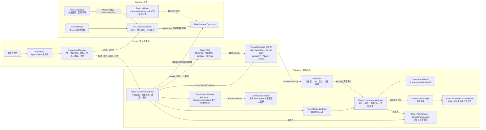
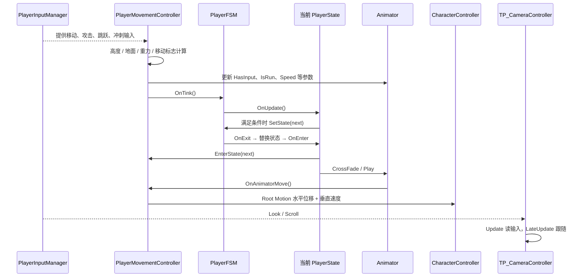

# Event_Stream 3C 功能架构图

> 基于 `D:\unity\Event_Stream` 当前 `main` 工作区源码静态分析。3C 按 Character、Camera、Control 划分。

## 一帧内的主流程

## 代码依据

- `Assets/Scripts/Manager/PlayerInput/PlayerInputManager.cs`
- `Assets/Scripts/Controller/PlayerMovementController.cs`
- `Assets/Scripts/Base/PlayerControllerBase.cs`
- `Assets/Scripts/FSM/PlayerFSM.cs`
- `Assets/Scripts/Base/PlayerStateBase.cs`
- `Assets/Scripts/State/*.cs`
- `Assets/Scripts/Controller/PlayerComboController.cs`
- `Assets/Scripts/Base/PlayerComboControllerBase.cs`
- `Assets/Scripts/Camera/CameraController.cs`
- `Assets/Scripts/Camera/CameraCollider.cs`
- `Assets/Scripts/Camera/FreeLookZoom.cs`

> `FreeLookZoom` 直接操作 `CinemachineFreeLook` 的轨道半径；当前源码无法证明它与自定义 `TP_CameraController` 必然同时挂在同一相机对象上，因此图中标为可选分支。
